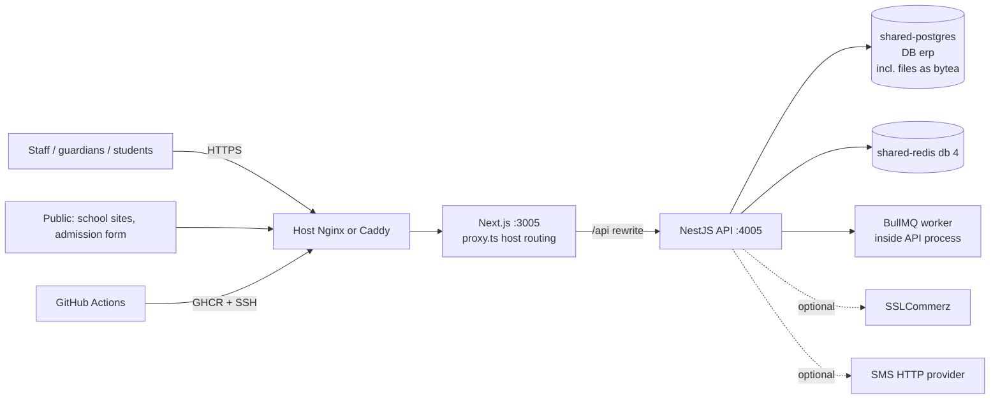

# School & College ERP ("Campus One") — Architecture Inventory

Audited commit: `2e11d6a` (main, 2026-11-13). 163 tracked files. Static evidence from source.

## 1. Repository layout

| Path | Contents |
|---|---|
| `backend/` | NestJS API (`src/`), Prisma schema + 3 migrations, two seeds (`seed.ts`, `seed-saas.ts`), `setup/` (env generator, platform bootstrap, verify script, Caddyfile), tests, docs, dev `compose.yaml`, **inactive** CI at `backend/automation/workflows/ci.yml` |
| `frontend/` | Next.js app: marketing landing, tenant sign-up, ERP workspace, platform console, public admission form, tenant school websites; Playwright specs incl. accessibility |
| `deploy/` | Production compose, env template, README |
| `.github/workflows/deploy.yml` | Build → GHCR → SSH deploy (migrates before start, with pull retries) |
| `.gitignore` (root) | Attacker-added remnant |

## 2. Technology inventory

| Layer | Technology |
|---|---|
| Runtime | Node ≥ 22 (`node:22-bookworm-slim`) |
| API | NestJS 11 / Express, global prefix `/api`, `express.json({limit:"8mb"})` |
| ORM / DB | Prisma 6.19, PostgreSQL; explicit pool (`connection_limit=10`, `pool_timeout=15`) in `src/db.ts` |
| Validation | zod 4 (`src/common.ts`), validated env config (`src/config.ts`) |
| Auth | JWT HS256 8 h with issuer/audience, httpOnly cookie `campus_session` (`SameSite=Lax`) or Bearer; bcryptjs cost 12; `tokenVersion` revocation; global `AccessGuard` |
| Rate limiting | `express-rate-limit` 8 (memory store) on `/api`, login, register, admissions; Redis-based limiter for public website actions (`Jobs.publicLimit`) |
| Jobs | BullMQ worker **inside the API process** (`src/jobs.ts`), concurrency 4; repeatable `maintenance` every 60 s; `sms` and `absence` jobs |
| Realtime | Socket.IO gateway at `/api/socket.io` emitting `refresh` events to user and campus rooms |
| Documents | pdfkit (report card, fee receipt, subscription receipt) |
| Files | Stored in PostgreSQL: admission documents (AES-256-GCM, `AdmissionDocument.encryptedData`), website assets (`WebsiteAsset.content`) |
| Payments (fees) | Manual entry by accounts staff; optional SSLCommerz hosted checkout with server-side validation |
| Payments (SaaS) | Manual bKash/Nagad/bank reference reviewed by platform admin |
| SMS | `console` (simulated) or generic HTTP provider |
| Frontend | Next.js App Router standalone, React, plain CSS (≈ 5,000 lines across 4 files), `src/proxy.ts` host-based routing for school sites |

## 3. Backend modules (`backend/src`)

| Area | Files | Responsibility |
|---|---|---|
| Bootstrap | `main.ts`, `app.module.ts`, `config.ts`, `common.ts`, `db.ts`, `health.ts` | Middleware, rate limits, origin check, error filter, serial transaction helper, liveness/readiness |
| Auth | `auth/auth.controller.ts`, `auth/access.ts`, `auth/scope.ts`, `auth/rate-limit.ts` | Login, me, logout, password; guard with roles, platform/account/billing access, feature gates; data scoping by role |
| SaaS | `saas/policy.ts`, `saas/service.ts`, `saas/controllers.ts` | Plans, trial, quotas, feature entitlements, payment requests, review, grants, suspension, platform console |
| Core modules | `modules/campuses.ts`, `academics.ts`, `students.ts`, `users.ts`, `admissions.ts`, `uploads.ts`, `attendance.ts`, `exams.ts`, `fees.ts`, `billing.ts`, `payments.ts`, `payment.service.ts`, `documents.ts`, `notices.ts`, `reports.ts`, `lifecycle.ts` | Campuses, sessions, holidays; classes, sections, subjects, teacher assignments, timetable; students and guardians; staff; online admission, merit list, seat offers, encrypted documents; attendance and leave; exam terms, marks, publication, results; fee structures, invoice generation, waivers; payments; PDFs; notices and SMS log; dashboards; promotion and transfer |
| Optional modules (feature-gated) | `modules/library.ts`, `transport.ts`, `homework.ts`, `support.ts` | Library books/loans/reservations; routes/stops/assignments/trips/billing; homework and submissions; support tickets |
| Websites | `websites/service.ts`, `controllers.ts`, `content.ts`, `results.ts`, `domains.ts` | Tenant school website CMS with revisions, publishing, custom domains, assets, inquiries, public result lookup |
| Domain | `domain/grading.ts`, `domain/fees.ts`, `domain/workflow.ts` | GPA/grade calculation, FIFO allocation and late fine, state transitions |
| Infra | `jobs.ts`, `realtime.ts`, `audit.ts` | Queue, sockets, audit log |

## 4. API inventory (under `/api`)

| Area | Routes |
|---|---|
| Auth | `POST auth/login`, `GET auth/me`, `POST auth/logout`, `POST auth/password` |
| SaaS (tenant) | `GET saas/plans` (public), `POST saas/register` (public), `POST saas/organizations`, `GET saas/me`, `PATCH saas/organization`, `POST saas/payment-requests`, `GET saas/payments/:id/receipt` |
| Platform | `GET platform/dashboard`, `GET platform/organizations/:id`, `POST platform/payments/:id/review`, `POST platform/organizations/:id/grant`, `PATCH platform/organizations/:id`, `PATCH platform/settings`, `GET platform/audit`, `PATCH platform/plans/:id` |
| Campus | `GET/POST campuses`, `GET campuses/:id/sessions`, `POST sessions`, `PATCH sessions/:id`, `GET/POST holidays` |
| Academics | `GET teachers`, `GET/POST classes`, `GET/POST sections`, `GET/POST subjects`, `POST assignments`, `GET/POST timetable` |
| People | `GET/POST students`, `GET students/:id`, `POST students/:id/guardians`, `GET/POST users` |
| Admissions | `GET admissions/options` (public), `POST admissions/applications` (public), `GET admissions/applications`, `PATCH …/:id`, `POST admissions/merit-lists/generate`, `POST …/applications/:id/offer`, `POST admissions/offers/:token/…` (public), document upload (public, token), list, download (token) |
| Attendance | `GET attendance`, `POST attendance/bulk`, `GET/POST leaves`, `PATCH leaves/:id` |
| Exams | `GET/POST exams/terms`, `PATCH exams/terms/:id`, `GET/POST exams/terms/:id/marks`, `POST exams/terms/:id/publish`, `GET exams/results/:studentId` |
| Fees | `GET fees/invoices`, `GET/POST fees/structures`, `POST fees/generate`, `GET/POST fees/waivers`, `POST fees/waivers/:id/approve` |
| Payments | `GET payments`, `GET payments/config`, `POST payments/intent`, `POST payments/return` (public), `POST payments/webhooks/sslcommerz` (public) |
| Documents | `GET students/:id/report-card`, `GET payments/:id/receipt` |
| Communication | `GET/POST notices`, `POST notices/:id/…`, `GET notices/sms` |
| Lifecycle | `POST lifecycle/promote`, `POST lifecycle/transfer` |
| Reports | `GET reports/dashboard`, `…/fee-collection`, `…/attendance-summary`, `…/audit`, `GET guardians/me/dashboard` |
| Library / Transport / Homework / Support | CRUD and workflow routes under `library/*`, `transport/*`, `homework/*`, `support/*` |
| Website | `website/*` (draft, publish, restore, domains, assets, inquiries), `public-websites/*` (resolve, media, pages, inquiries, results) |
| Health | `GET health/live`, `GET health` (database + Redis readiness) |

## 5. Database entities (≈ 55 models)

- **SaaS:** `Organization`, `OrganizationMember`, `SubscriptionPlan`, `Subscription`, `SubscriptionPayment`, `SubscriptionEvent`, `PlatformSettings`
- **Structure:** `Campus`, `AcademicSession`, `SchoolClass`, `Section`, `Subject`, `SectionSubjectTeacher`, `TimetableSlot`, `Holiday`, `GradeScale`
- **People:** `User`, `UserCampusRole`, `Student`, `GuardianStudent`, `Enrollment`
- **Admissions:** `AdmissionApplication`, `AdmissionDocument`, `SeatOffer`
- **Academics:** `AttendanceRecord`, `LeaveRequest`, `ExamTerm`, `ExamMark`, `Homework`, `HomeworkSubmission`
- **Finance:** `FeeStructure`, `FeeHead`, `Invoice`, `InvoiceLine`, `Payment`, `PaymentAllocation`, `Waiver`
- **Communication:** `Notice`, `SmsMessage`, `SupportTicket`, `TicketComment`
- **Library / Transport:** `LibraryBook`, `LibraryLoan`, `LibraryReservation`, `TransportRoute`, `TransportStop`, `StudentTransport`, `TransportTrip`
- **Websites:** `SchoolWebsite`, `WebsiteRevision`, `WebsiteDomain`, `WebsiteAsset`, `WebsiteInquiry`
- **Audit:** `AuditLog`

## 6. Tenancy as implemented

`Organization` (tenant) → `Campus` → campus-scoped data. Users are global (unique email) with `OrganizationMember` and per-campus roles (11 roles). The guard resolves the active campus from the `x-campus-id` header only when the user holds a role there. See `tenant-isolation-review.md`.

## 7. Deployment

Compose project `erp`: `backend` (host 4005 → 4000, 416 MB limit, Node health check), `frontend` (3005 → 3000). Shared `shared-postgres` and `shared-redis` (Valkey, database 4) on `apps-net`. Redis is required. School sites are served at `<subdomain>.<SCHOOL_SITE_BASE_DOMAIN>`; custom domains need a real base domain (currently an `sslip.io` name). `backend/setup/bootstrap.ts` creates the platform administrator and plans without demo data.

## 8. Current architecture diagram

